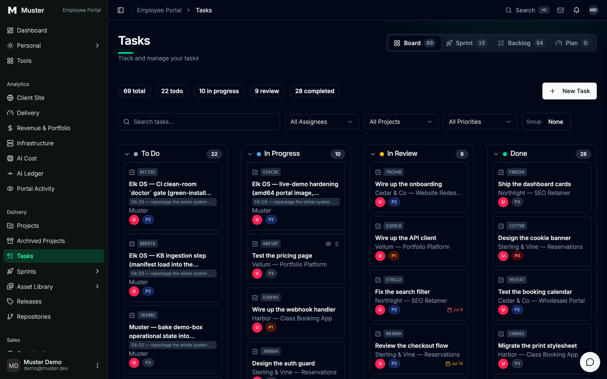

<h1 align="center">Muster</h1>

<p align="center">
  <strong>Your back office, wired into Claude Code.</strong><br>
  Projects, clients, invoices, knowledge, assets, and delivery records in one
  self-hosted system your agents can update while they work.
</p>

<p align="center">
  <a href="https://musterr.dev">Site &amp; whitepaper</a> ·
  <a href="https://app.musterr.dev">Live demo</a> ·
  <a href="https://github.com/AnalogElk/muster">Source</a><br>
  <sub>The demo is a static snapshot with no sign-in: the
  <a href="https://app.musterr.dev">team view</a> and the
  <a href="https://app.musterr.dev/client-portal/">client view</a>.
  (musterr.dev has two Rs on purpose.)</sub>
</p>

<p align="center">
  <a href="https://github.com/AnalogElk/muster/releases"></a>
  <a href="./LICENSE"></a>
  <a href="https://app.musterr.dev"></a>
</p>

> **Naming note:** the product is **Muster**. The CLI is `bin/elk-os` and the env
> vars are `ELK_OS_*`, from the project's working name. Renaming those is a
> tracked decision, not an accident. They refer to the same thing.

---

Claude Code is stateless; your business is not. Muster keeps the records that
outlive a session in a Directus you host, and gives your agents a door into them
over MCP. The row you check in the portal is the row an agent can update while it
works.

```bash
git clone https://github.com/AnalogElk/muster.git && cd muster
./bin/elk-os init --profile generic         # generate secrets + .env
./bin/elk-os up                             # docker compose up the whole stack
./bin/elk-os migrate && ./bin/elk-os seed   # os_* schema + profile data
./bin/elk-os wire                           # point Claude Code at this deployment
./bin/elk-os doctor                         # per-subsystem health report
```

<p align="center">
  <a href="https://app.musterr.dev"></a><br>
  <sub>The live team portal at <a href="https://app.musterr.dev">app.musterr.dev</a>. The demo is synthetic and read-only.</sub>
</p>

Docker is the hard dependency. `migrate` and `seed` also use stdlib `python3`;
building the portal image locally additionally needs `git`, `node`, and `perl` on
the host, and `prepare-context.sh` preflights them with the alternatives spelled
out. Secrets are generated into a gitignored `.env` and never printed.

> **Fresh-clone note:** the portal image builds from a *local checkout* of
> `analog-elk-front-end` (see [`portal/`](./portal/)), which a fresh clone does
> not have. `up` stops with the alternatives spelled out. Either set
> `ELK_OS_WITH_PORTAL=false` in `.env` (Directus and the records still stand up)
> or pull published images (`ELK_OS_USE_PUBLISHED_IMAGES=true` plus
> `PORTAL_IMAGE` / `RAG_IMAGE`).

## What is in it

The schema ships **50 snapshot entries: 38 `os_*` collections, 6 support tables,
and 6 groups that only organize the Directus sidebar**
([`KEPT-AND-PRUNED.md`](./directus/schema/KEPT-AND-PRUNED.md)). They add up to
five desks and a second front door.

| Desk | Holds |
|---|---|
| **Delivery desk** | Projects, tasks, sprints, releases, repositories. What's claimed, what's blocked, what actually shipped. |
| **Money desk** | Deals, proposals, invoices, payments, expenses, services, packages. A ledger, not accounting software. |
| **Studio operations** | Organizations, contacts, activities, support, messages, your own inbox. The studio's records, not its employment paperwork. |
| **Knowledge and assets** | A knowledge base for what you've learned; an asset library for what you've made, with review states and brand guidelines attached. |
| **Operations view** | One dashboard over the rest: site, portfolio, delivery, and infrastructure analytics, plus a cost ledger for what the agents spent. |
| **Client portal** | The second front door. Clients sign in to the same records, scoped to what they may see. |

## The four subsystems

One `elk-os up` stands up four wired pieces:

| Subsystem | What it is |
|---|---|
| **The Claude Code connection** | A governance file (`CLAUDE.md`), an MCP bridge, SessionStart hooks, and persistent memory, rendered per deployment by `elk-os wire`. |
| **Directus + `os_*`** | The shared record store. Directus's **native MCP server** (`/mcp`) is the agent's door to it. |
| **The retrieval engine** | A local RAG service (Postgres + Qdrant + Redis + FastAPI) plus the in-portal assistant, answering over your own knowledge base and record data. Embeddings run on the box. |
| **The portal** | The human surface, team and client, a Next.js app over the same `os_*` records. |

## The loop, concretely

```
        ┌─────────────────────────────────────────────────────┐
        │            Directus  +  the os_* records            │
        │      (tasks · sprints · projects · releases)        │
        └───────────────▲───────────────────────▲─────────────┘
       drags a card in  │                       │  reads/writes via the
         the portal     │                       │  native Directus MCP (/mcp)
                  ┌──────┴──────┐         ┌──────┴───────────┐
                  │    Human    │         │  Claude agents   │
                  │  (portal)   │         │ (wired CLAUDE.md)│
                  └─────────────┘         └──────────────────┘
```

`elk-os wire` enables the native MCP server (`settings.mcp_enabled`), writes a
`.mcp.json` pointing Claude at *this* deployment's Directus, and proves the loop
by reading seeded `os_tasks` back through the same endpoint and token. `doctor`
then walks every subsystem, including a live `tools/list` probe against `/mcp`
(a WARN until wired), and exits nonzero on any red row.

## As a Claude Code plugin

You do not have to self-host to try it. The plugin connects to the public demo:

```
/plugin marketplace add AnalogElk/muster
/plugin install muster@muster
/muster:connect
```

Two commands to install, then one to connect. Four slash commands
(`connect`, `board`, `up`, `doctor`), one skill, one SessionStart hook, and one
MCP server connection, all named in
[`.claude-plugin/plugin.json`](./.claude-plugin/plugin.json). The first MCP tool
call asks you to approve it, once. There is no zero-click connection.

## Why not just a plain Claude Code session?

A plain session is the right tool for a large class of work. Muster is what you
wrap around it when the work is multi-session, ships to others, and cannot be
reviewed line by line:

| A plain Claude Code session | Muster |
|---|---|
| One rolling context window is the project memory | Durable records, on-disk memory, and an append-only log survive every session |
| Serial by default; two agents clobber one checkout | Disjoint assignment and worktree isolation around one shared set of records |
| The builder audits its own work, sharing its blind spots | Adversarial verifiers and from-scratch loop proofs |
| Rules live in a human's head and drift | A written governance file loaded into every session |

The honest version of this table, including which rows a disciplined single agent
can match, is [whitepaper section 7](https://musterr.dev/paper.html).

## The retrieval engine

The records are where work happens. The retrieval engine is how the system
answers questions about itself, under one strict rule: **the engine is never
trusted for what a user is allowed to see.**

**Local retrieval.** Muster embeds the engine from the `analog-elk-v3` project: a
FastAPI service backed by Postgres 15, Qdrant, and Redis. Embeddings are
generated on the box with [fastembed](https://github.com/qdrant/fastembed) using
`BAAI/bge-small-en-v1.5` (384-dimensional vectors, ONNX on CPU). Retrieval and
indexing run locally: no external inference, no embedding API key, no quota, and
no document text leaving the machine. The engine's only host exposure is a
loopback binding (`127.0.0.1:19100`, `RAG_API_PORT`), which is how
`bin/elk-os doctor` and host-side tools reach it.

**The portal assistant.** On top of the engine sits an in-portal assistant that
answers over your own knowledge base and `os_*` records. It is a grounding window
over the knowledge, not a second place to coordinate work. The task record, not a
chat transcript, stays the coordination surface.

**The untrusted-oracle model.** This is the load-bearing design decision. The
engine indexes everything it is given, including gated and unpublished pages, so
its raw output can never decide visibility. The assistant uses it only to *rank*
candidate document slugs. Every candidate is then re-fetched through Directus
under the caller's own token and re-gated by the portal's role-based filter
(`buildPageFilter`) before a line reaches the model's context. Retrieval ranks;
permissions decide.

**Hardening.** Read-key auth on `/query`, `/stats`, and the ingest routes
(constant-time comparison) once a key is set. A fail-closed startup guard: outside
development the engine refuses to boot without `RAG_API_KEY`, so a misconfigured
deploy cannot silently ship an open API. A Redis-backed fixed-window rate limiter
(default 300 req/min per key) inside the engine, since stock Caddy on the ingress
has no rate-limit module. And orphaned-vector reconciliation, so a deleted
document's vectors go with it and a stale snippet cannot come back through
semantic search.

> **Honest note on generation.** Retrieval and embeddings are local and keyless.
> The step that *writes* an answer uses whatever model provider you configure
> (`ANTHROPIC_API_KEY` plus `ASSISTANT_MODEL`, both passed through `.env`; see
> `.env.example`). The "no external inference" claim is scoped to the engine,
> which is where your documents live. Do not read it as "nothing leaves the box".
> Without a generation key the assistant answers with an honest notice rather
> than a broken box.

## Profiles

| Profile | Stands up |
|---|---|
| `generic` | A blank slate seeded with a synthetic "Demo Co", schema and seed data scrubbed of origin. Make it your own. |
| `analogelk` | Analog Elk's own demo data (the reference instance). |

> Honest note: the portal **UI** ships Muster-branded for *every* profile. The
> rebrand is applied at image build (`portal/prepare-context.sh`), not switched
> per profile. Per-profile portal branding is a tracked follow-up.

```bash
./bin/elk-os init --profile analogelk
```

## The CLI

An idempotent phased installer (`.elk-os-state.json` records completed phases;
every phase is safe to re-run and completed work no-ops, so you can stop at any
point and pick the sequence back up):

| Command | Does |
|---|---|
| `init` | Generate secrets and write `.env` from `.env.example`. |
| `up` | `docker compose up` the core (plus RAG and portal), then mint the admin static token. |
| `migrate` | Apply the pruned `os_*` schema snapshot (idempotent diff and apply). |
| `seed` | Load the profile's seed data (idempotent upsert). |
| `wire` | Render the Claude Code connection, enable the native MCP server, prove the loop. |
| `doctor` | Per-subsystem health report, the runtime acceptance test. |
| `logs [service]` | Tail container logs (for example `directus`, `elkos-rag-api`). |
| `rebuild-portal` | Re-prepare the pinned context and rebuild the portal image. |
| `down` | Stop the stack (`--volumes` to wipe data). |

## Deploy options

| Path | Hosts | Best for |
|---|---|---|
| **Box** ([`provision/`](./provision/)) | the **whole stack** behind Caddy and TLS | The reliable full-stack path: a VPS and a domain. |
| **Render** ([`deploy/render.yaml`](./deploy/render.yaml)) | Directus + Postgres + portal | A managed PaaS, fewest manual steps. |
| **Fly / Railway** ([`deploy/`](./deploy/)) | per-service, wired by hand | If you already live there. |
| **Netlify** ([`deploy/netlify/`](./deploy/netlify/)) | the portal **front-end only** | Putting the UI on a CDN. **Requires a Directus you host elsewhere.** |

**The honest caveat:** the portal **fail-fasts without a reachable Directus
backend**. A front-end-only host hosts the UI, not the backend. The backend
(Postgres, Directus, RAG, native MCP) needs a real host, and the box is the
reliable full-stack path. The portal image ships via GHCR and cannot be built on
a bare PaaS; the GHCR packages currently require a `docker login ghcr.io` while
the public image release is prepared (tracked). See [`provision/`](./provision/)
and [`deploy/README.md`](./deploy/README.md).

The live demo was built on the box path: [`provision/`](./provision/) holds the
scripts that made the public demo real, including `seed-demo.py`, `re-add-kb.py`,
and `demo-readonly-role.py` (which locked the demo logins to read-only). Since
2026-08-02 the public demo is a static snapshot of that box, crawled page by page
and served as plain files, so it has no login and cannot write. [`site/`](./site/)
is the homepage at the demo root.

## What is regenerated post-clone

- **`portal/.build/`** is the portal's Docker build context, a *frozen archive* of
  a pinned `analog-elk-front-end` commit, reproduced on demand by
  `portal/prepare-context.sh`. Gitignored, never committed.
- **`wire/`** is the per-deployment Claude config, rendered by `elk-os wire` from
  the committed [`claude-os/`](./claude-os/) templates. It bakes absolute local
  paths and references the token by env name only. Gitignored; regenerate any time
  with `elk-os wire`.

## What it does not do

1. Muster does not make Claude smarter or run agents in the background. It gives
   instructed agents shared records and a protocol.
2. The first MCP tool call requires approval in Claude Code. There is no
   zero-click connection.
3. The public demo is synthetic and read-only. It proves shared reads, not agent
   writes or self-hosting.
4. A clean self-host does not reproduce every demo section. The base snapshot
   omits demo enrichment and some portal dependencies, and the portal requires a
   published image or a separate source checkout.
5. The Money desk is not accounting software. There is no double-entry ledger,
   bank feed, reconciliation, tax workflow, or bookkeeping automation.
6. Studio operations is not HR software. There is no payroll, hiring, benefits,
   leave management, or time tracking.
7. Connected-service views require their own credentials. Without them, a view may
   be empty, unavailable, or explicitly mocked.
8. Task claims are not atomic locks. Avoiding collisions requires disjoint
   assignments and worktree isolation.
9. Retrieval and embeddings can run locally. Answer generation uses the configured
   model provider.
10. Muster is unnecessary for work that fits in one context and has no back-office
    records to maintain.

## Versioning and releases

Versioning is automated via [release-please](https://github.com/googleapis/release-please)
(`release-type: simple`; this is a bash and compose repo, not a Node package). The
version of record lives in [`version.txt`](./version.txt); the narrative in
[`CHANGELOG.md`](./CHANGELOG.md). Every commit and PR title must be a valid
[Conventional Commit](https://www.conventionalcommits.org/) (`feat:` to minor,
`fix:` / `perf:` to patch, `feat!:` to major). On tag, service images publish to
GHCR ([`publish-images.yml`](./.github/workflows/publish-images.yml)).

## Design and status

Full spec:
[`docs/superpowers/specs/2026-06-29-elk-os-installer-design.md`](./docs/superpowers/specs/2026-06-29-elk-os-installer-design.md).
Per-phase status, shipped against aspirational, is tracked in
[`WHITEPAPER-LOG.md`](./WHITEPAPER-LOG.md). The loop (core, RAG, schema and seed,
portal, and the wired Claude Code connection) is proven on a from-scratch install,
and the public demo is up: [the site](https://musterr.dev) with
[the portal](https://app.musterr.dev) one link away.

## License

[MIT](./LICENSE) © Michael Walliser (Analog Elk). The `os_*` schema derives from
[directus-labs/agency-os](https://github.com/directus-labs/agency-os) (also MIT);
that attribution lives in [`NOTICE`](./NOTICE) and rides along with any
redistribution. Decision record: permissive licensing maximizes adoption and
trust; the business is services (hosting, support, custom builds). The code is the
credential, not the moat.

## Who built this

Built by **[Michael Walliser](https://walliser.me)**, creative technologist.
walliser.me is the "who built this / hire me" page.

**Muster by Analog Elk** ([analogelk.com](https://analogelk.com)). Elk is Mike's
dev brand; Analog Elk is the agency this system runs in production.

<sub>Off the clock, Mike shoots film at <a href="https://wlsr.me">wlsr.me</a>.</sub>
